# 🚗 붕붕어스 (BoongBoongUs) FE

<p align="center">
  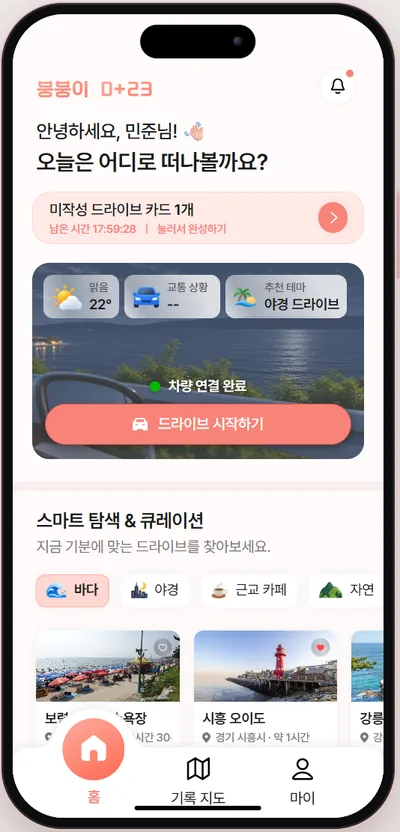
  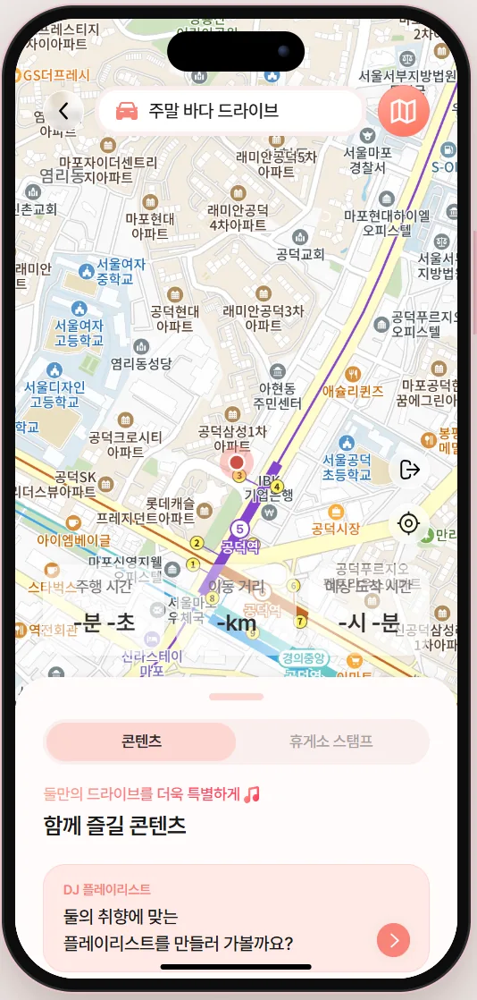
  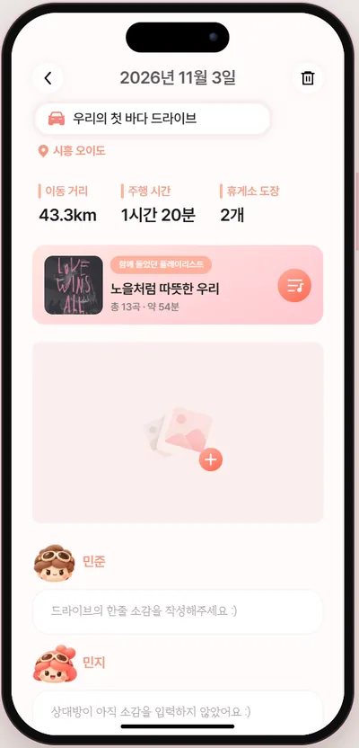
  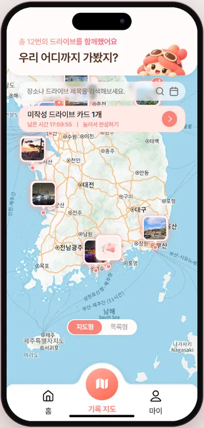
</p>

- 배포 URL : https://2026-line4thon-team6-fe.vercel.app
- 로그인 : 카카오 계정으로 로그인해요. 테스트 계정은 따로 없고, 로그인 없이 보려면 [로컬 실행](#10-로컬-실행)의 목 모드를 써요.
- 백엔드 저장소 : [boongboongus-backend](https://github.com/2026-line4thon-team6/boongboongus-backend)
- API 명세 : https://2026-line4thon-team6.github.io/boongboongus-backend/api/

<br>

## 프로젝트 소개

- 붕붕어스는 연인과 함께하는 드라이브를 준비부터 기록까지 이어 주는 모바일 웹 서비스예요.
- 홈에서 오늘의 날씨와 추천 테마, 큐레이션 장소를 보고 바로 드라이브를 시작할 수 있어요.
- 주행 중에는 경로 안내와 함께 휴게소 도장, DJ 플레이리스트, AI 라디오, 둘이 하는 게임을 즐길 수 있어요.
- 도착하면 24시간 안에 드라이브 카드에 사진과 각자의 한 줄 소감을 남기고, 기록 지도에서 다녀온 곳을 한눈에 모아 봐요.
- 연인 코드로 커플을 연결하고, 장소 공유 · 카드 완성 같은 소식을 알림과 휴대폰 푸시로 받아요.

<br>

## 팀원 구성 (FE)

<div align="center">

| **khy1121** | **huisuu4** |
| :------: | :------: |
| [ <br/> @khy1121](https://github.com/khy1121) | [ <br/> @huisuu4](https://github.com/huisuu4) |

</div>

<br>

## 1. 개발 환경

- Front : React 19, TypeScript 6, Vite 8, SCSS Modules, React Router 8
- 지도 : Kakao Maps JavaScript SDK (`react-kakao-maps-sdk`)
- 테스트 : Vitest 5 + Testing Library (jsdom), Storybook 10 (로컬 전용)
- 패키지 매니저 : pnpm 12 (CI는 Node 24)
- Back-end : Spring Boot · PostgreSQL ([백엔드 저장소](https://github.com/2026-line4thon-team6/boongboongus-backend))의 REST API `/api/v1`
- 배포 : Vercel (`main` 자동 배포, PR마다 프리뷰 배포)
- CI : GitHub Actions (`lint` → `test` → `build`)
- 버전 및 이슈 관리 : GitHub Issues, Pull Requests (이슈 · PR 템플릿 사용)
- 디자인 : [Figma](https://www.figma.com/design/iVcryRTtlYHzHq2JM5wyHQ/)

<br>

## 2. 채택한 개발 기술과 브랜치 전략

### React 19 + TypeScript + Vite

- 화면은 props만 받는 `pages/`와, 데이터를 불러와 넘겨 주는 라우트(`App.tsx`, `routes/`)로 나눴어요. 화면을 데이터 없이도 테스트 · 스토리로 확인할 수 있어요.
- React 19의 `ViewTransition`으로 목록 → 상세, 카드 열기 같은 화면 전환을 자연스럽게 이었어요.
- TypeScript 타입은 API 명세의 스키마를 그대로 옮겨 `src/types`에 두었어요.

### SCSS Modules + 디자인 토큰

- Figma의 색 · 글자 스타일을 `styles/abstracts`의 `color()`, `typo()`, `glass` 믹스인으로 만들어 모든 화면이 같은 토큰을 써요.
- 컴포넌트마다 `*.module.scss`를 둬서 클래스 이름이 겹치지 않아요.

### API 계층과 목 모드

- 모든 요청은 `src/api/*`를 거쳐요. `VITE_API_BASE_URL`이 없거나 서버가 응답하지 않으면 `src/mocks`의 목 응답을 돌려줘요.
- 그래서 백엔드 API가 나오기 전부터 화면을 만들고, API가 나오면 목만 걷어 내고 바로 붙였어요.
- 토큰 만료 시 한 번만 갱신하고(같은 리프레시 토큰은 같은 `Idempotency-Key`), 다시 보내요.

### Vitest + Testing Library (TDD)

- 기능명세서 항목을 먼저 테스트로 쓰고 구현했어요. 테스트 파일 137개, 테스트 1,000개 이상이에요.
- 사용자 입장(역할 · 이름으로 요소 찾기)으로 테스트해서, 접근성 이름도 함께 지켜져요.

### PWA

- `manifest.webmanifest`와 서비스 워커(`public/sw.js`)로 홈 화면에 설치할 수 있고, 오프라인일 때는 저장해 둔 앱 화면을 열어요.
- Web Push로 커플 연결 · 해제, 장소 공유, 카드 완성 소식을 앱을 닫아도 휴대폰 알림으로 받아요.
- 새 배포가 올라오면 "새 버전이 있어요 [업데이트]" 배너로 알려 줘요 (`/version.json` 비교).

### 브랜치 전략 · 컨벤션

- `main` 하나를 배포 브랜치로 두고, 작업마다 기능 브랜치를 만들었어요.
  - **main** : 운영 배포 브랜치. 머지되면 Vercel이 바로 배포해요.
  - **feat/ · fix/ · chore/** : 작업 단위 브랜치. 이슈를 만들고 PR로 머지한 뒤 지워요.
- 이슈 → 브랜치 → PR(템플릿) → CI 통과 → 리뷰 → squash merge 순서로 진행했어요.
- 커밋 메시지는 `[Feat] 한글 설명` 형식이에요. `[Feat]` 기능, `[Fix]` 버그 수정, `[Chore]` 설정 · 기타.

<br>

## 3. 프로젝트 구조

```
├── .github
│    ├── ISSUE_TEMPLATE         # 기능 · 버그 · 작업 이슈 템플릿
│    ├── pull_request_template.md
│    └── workflows/ci.yml       # lint → test → build
├── .storybook                  # Storybook 설정 (로컬 전용)
├── docs/images                 # README 화면 캡처
├── public
│    ├── icons                  # PWA 아이콘
│    ├── mocks                  # 목 데이터용 이미지
│    ├── manifest.webmanifest
│    ├── sw.js                  # 서비스 워커 (오프라인 화면 · Web Push)
│    └── qa.html                # 팀 QA 체크 페이지
├── src
│    ├── api                    # API 호출 계층 (실서버 / 목 전환)
│    ├── assets                 # 아이콘 · 이미지 · 폰트
│    ├── components             # 공통 컴포넌트 (BottomSheet, Modal, GlassIconButton ...)
│    ├── constants
│    ├── hooks                  # 데이터 훅 (useHome, useRecordMap, usePushNotifications ...)
│    ├── mocks                  # 목 응답
│    ├── pages                  # 화면 (props만 받음)
│    │    ├── Home · PlaceDetail · RecordMap · RecordDetail · DriveCard
│    │    ├── Drive · RouteSetting · DjPlaylist · DriveRadio · Game · RestAreaSearch
│    │    ├── My · Couple · CoupleInvite · Archive · Notifications · Faq
│    │    └── Login · Onboarding · LegalDocument · PublicPlace · RadioStory
│    ├── routes                 # 로그인 · 온보딩 라우트
│    ├── styles                 # 디자인 토큰 · 믹스인 · 전역 스타일
│    ├── test                   # 테스트 설정
│    ├── types                  # API 명세 타입
│    ├── utils
│    ├── App.tsx                # 라우트와 데이터 연결
│    └── main.tsx
├── index.html
├── vercel.json
└── vite.config.ts
```

<br>

## 4. 역할 분담

### @khy1121

- **화면** : 홈, 장소 상세, 기록 지도(지도형 · 목록형 · 미리보기 · 날짜 검색 · 공유), 기록 상세, 드라이브 카드, 마이 · 커플 · 보관함, 로그인 · 온보딩 · 연인 초대, 알림
- **기능** : 카카오 로그인과 토큰 갱신, API 계층과 목 모드, 휴대폰 알림(Web Push, 백엔드 발송 포함), 앱 업데이트 안내, 화면 전환 애니메이션
- **공통** : 디자인 토큰 · 공통 컴포넌트, Vercel 배포, GitHub Actions CI, QA 페이지

<br>

### @huisuu4

- **화면** : 드라이브 주행 화면, 경로 설정, 휴게소 검색 · 도장, DJ 플레이리스트, AI 라디오, 드라이브 게임(밸런스 · 기억력 · 넌센스)
- **기능** : 주행 화면의 지도 · 경로 표시, 드라이브 이름 정하기 시트, 드라이브 모드 공통 컴포넌트
- **공통** : 프로젝트 폰트 적용

<br>

## 5. 개발 기간 및 작업 관리

### 개발 기간

- 전체 개발 기간 : 2026-10-26 ~ 진행 중
- 머지된 PR 115개, 이슈 113개 (2026-11-19 기준)

<br>

### 작업 관리

- GitHub Issues와 Pull Requests로 진행 상황을 공유했어요. 이슈 · PR 모두 템플릿을 써요.
- PR마다 Vercel 프리뷰가 올라와서, 디자이너가 실제 화면을 보고 리뷰했어요.
- 배포 화면을 기준으로 QA 케이스를 정리한 `/qa.html` 페이지를 두고 결과를 함께 기록했어요.

<br>

## 6. 신경 쓴 부분

- **백엔드보다 먼저, 백엔드와 같은 모양으로** : 화면은 API 명세 타입과 목 응답으로 먼저 만들고, 명세에 없는 값은 임의로 채우지 않고 숨기거나 백엔드에 요청했어요.
- **모바일 웹 우선** : 카카오톡 인앱 · 크롬 · 사파리에서 폭 320~430px, safe-area, iOS 입력칸 자동 확대, 삼성 인터넷 강제 다크 모드까지 맞췄어요. 데스크톱에서는 아이폰 프레임 안에 보여 줘요.
- **기다리지 않는 화면** : 사진 링크(서명 URL)가 만료되기 전에 다시 받고, 카드 사진 업로드는 일부가 실패해도 나머지를 지키도록 처리했어요.
- **같은 장소의 기록 묶음** : 지도 마커 하나에 여러 기록이 있으면 미리보기에서 화살표 · 끌기로 넘겨 봐요. 묶음 조회 API가 없어서 백엔드와 같은 규칙(장소 id, 없으면 좌표 소수 5자리)으로 FE에서 묶어요.
- **휴대폰 알림** : 기존 기기 등록 API에 Web Push 구독을 실어 보내고, 백엔드에서 RFC 8291 암호화 · VAPID 서명으로 직접 발송해요 (새 라이브러리 없음).

<br>

## 7. 페이지별 기능

### [로그인 · 온보딩]

- 카카오로 로그인해요. 처음 가입하면 약관 동의 → 닉네임 → 생일 → 성별 → 연인과 만난 날 → 붕붕이 이름 순서로 답해요.
- 마지막에 연인 코드를 입력하거나 내 코드를 공유해 커플을 연결해요.

<br>

### [홈]

- 연애 D+일수, 오늘의 날씨 · 교통 · 추천 테마를 보여 줘요.
- 바다 · 야경 · 근교 카페 같은 테마 칩으로 큐레이션 장소를 고르고, 하트로 찜해요.
- 24시간 안에 쓰지 않은 드라이브 카드가 있으면 배너와 팝업으로 알려 줘요.

| 홈 | 미작성 카드 알림 |
|----------|----------|
|  | 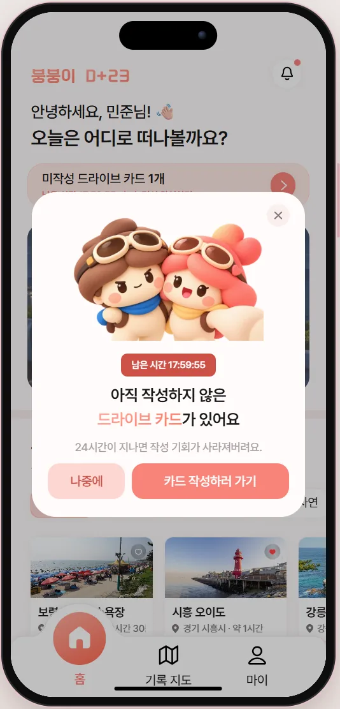 |

<br>

### [장소 상세]

- 장소 사진, 태그, 소개, 예상 소요 시간 · 주차 정보, 현재 위치 기준 경로 미리보기를 보여 줘요.
- **연인에게 보내기**로 장소를 공유하고, **드라이브 시작하기**로 이름만 정하면 바로 출발해요.

| 장소 상세 |
|----------|
| 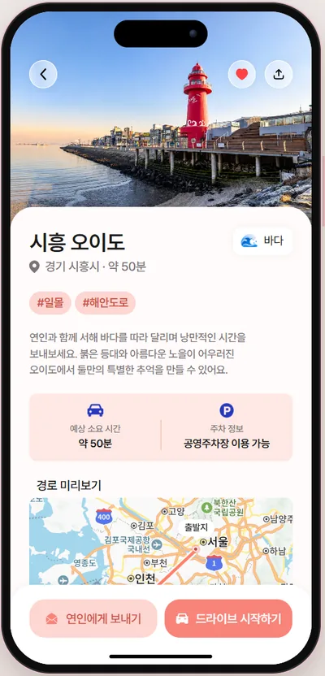 |

<br>

### [드라이브]

- 드라이브 이름을 정하면 출발해요. 지도에 현재 위치와 경로, 주행 시간 · 이동 거리 · 도착 예정 시간을 보여 줘요.
- 아래 시트에서 DJ 플레이리스트, AI 라디오, 게임 같은 콘텐츠와 휴게소 도장을 열어요.
- 목적지 100m 안에 30초 머무르면 서버가 도착으로 판정하고, 드라이브를 마친 뒤 카드 작성으로 이어져요.

| 드라이브 주행 |
|----------|
|  |

<br>

### [드라이브 카드]

- 이동 거리 · 주행 시간 · 휴게소 도장 수와 함께 들은 플레이리스트가 자동으로 채워져요.
- 사진을 최대 2장 올리고, 내 칸과 연인 칸에 각자 한 줄 소감(70자)을 남겨요.
- 드라이브를 마친 뒤 24시간 동안 수정할 수 있고, 기록하지 않으려면 카드를 폐기할 수 있어요.

| 드라이브 카드 작성 |
|----------|
|  |

<br>

### [기록 지도]

- 다녀온 곳을 대표 사진 마커로 지도에 모아 보여 줘요. 같은 장소에 기록이 여러 개면 `+N`으로 표시해요.
- 마커를 누르면 미리보기 카드가 뜨고, 같은 장소의 다른 기록은 양옆 화살표나 끌어서 넘겨 봐요.
- 목록형으로 바꾸거나, 제목 · 장소로 검색하거나, 캘린더로 날짜를 골라 찾을 수 있어요.
- 기록을 링크나 1080×1920 스토리 이미지로 공유해요.

| 지도형 | 미리보기 | 목록형 |
|----------|----------|----------|
|  | 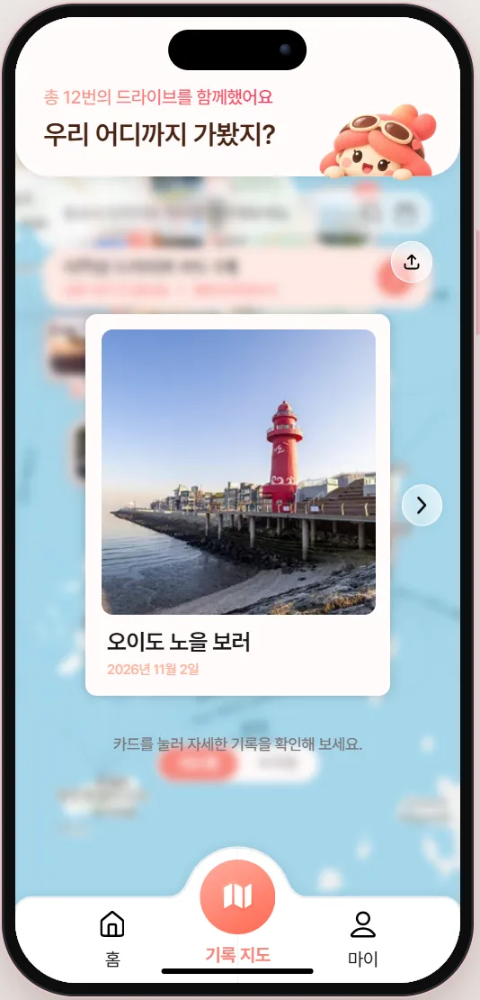 | 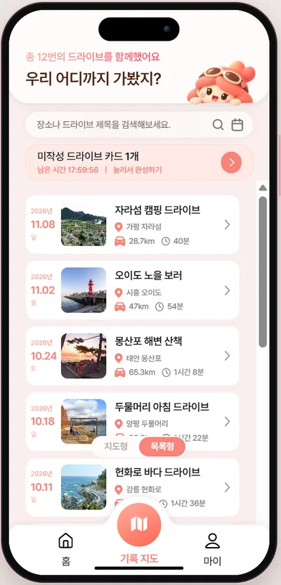 |

<br>

### [기록 상세]

- 날짜, 드라이브 이름, 목적지, 주행 기록, 플레이리스트, 사진, 두 사람의 소감을 보여 줘요.
- 삭제 권한이 있으면 오른쪽 위 휴지통으로 기록을 지워요.

| 기록 상세 |
|----------|
| 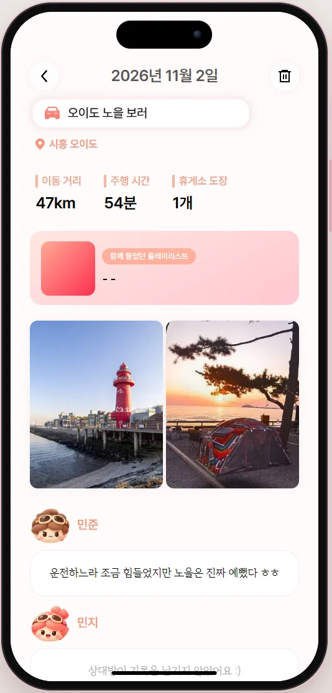 |

<br>

### [알림]

- 장소 공유, 소감 제출, 카드 완성, 커플 연결 · 해제 알림을 최근 7일 / 최근 30일로 나눠 보여 줘요.
- 알림을 누르면 장소 상세나 기록 상세로 이동해요.
- 위쪽의 **알림 켜기**로 휴대폰 알림(Web Push)을 받아요. 아이폰은 홈 화면에 추가한 앱에서만 받을 수 있어요.

| 알림 |
|----------|
| 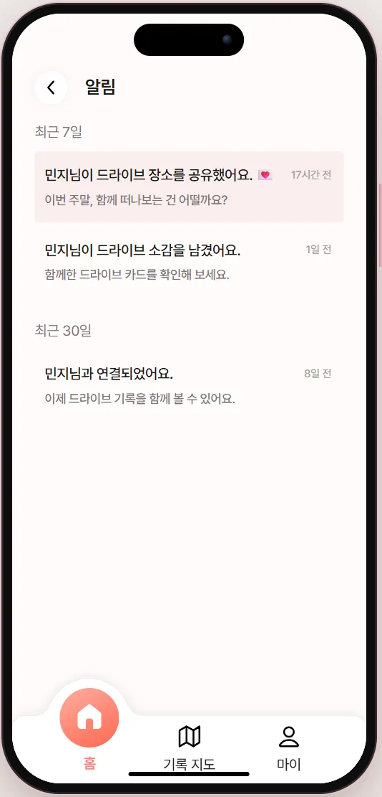 |

<br>

### [마이 · 커플]

- 붕붕이 프로필과 누적 거리, 찜한 드라이브 코스 · 플레이리스트 · 라디오 사연 보관함으로 이동해요.
- 약관 · FAQ, 로그아웃, 앱 설치 안내, 회원 탈퇴를 제공해요.
- 커플 페이지에서 사귄 날, 붕붕이 이름, 내 정보를 수정하고 커플 연결을 끊을 수 있어요.

| 마이 | 커플 페이지 |
|----------|----------|
| 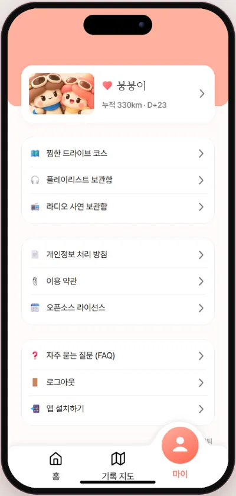 | 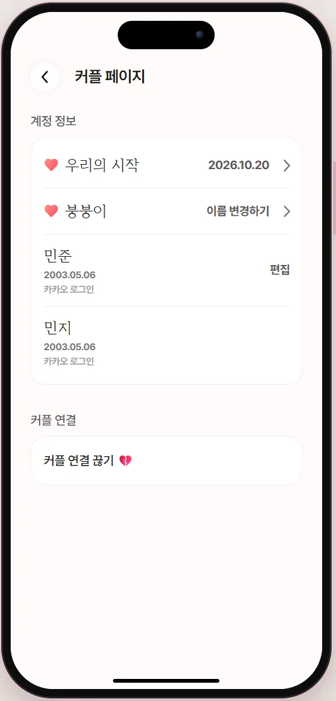 |

<br>

## 8. 트러블 슈팅

| 문제 | 원인 | 해결 |
|---|---|---|
| 앱을 켜자마자 첫 API가 401 | 자식 화면의 effect가 세션 복구보다 먼저 실행돼 토큰 없이 요청 | 앱을 열 때 저장된 액세스 토큰을 바로 실어 둠 |
| 동시에 401이 나면 토큰 갱신이 일부 실패 | 갱신 요청이 여러 번 나감 | 같은 리프레시 토큰이면 같은 `Idempotency-Key`로 갱신 |
| 기록 썸네일이 시간이 지나면 깨짐 | 사진이 만료 시간이 있는 서명 URL | 만료 전에 목록 · 지도를 다시 받아 링크 교체 |
| 기록 지도를 캡처해 공유하면 지도가 빔 | 카카오 지도 타일이 CORS를 허용하지 않아 canvas가 오염됨 | 지도 그림 + 기록 사진 마커 + 카드를 canvas로 직접 그려 스토리 이미지 생성 (#200) |
| 미리보기를 넘기면 옆 사진이 조금 남아 보임 | 소수점 폭에서 스크롤이 정수 위치에 멈춤 | 스크롤 대신 `transform`으로 한 장씩 정확히 이동 (#222) |
| 바텀시트가 열릴 때 화면 전체가 들썩임 | 포커스 이동 시 브라우저가 스크롤 | `focus({ preventScroll: true })` |
| 아이폰에서 입력칸을 누르면 화면이 확대됨 | iOS 사파리는 16px 미만 입력칸을 자동 확대 | 입력칸 16px 이상, viewport `maximum-scale=1` |
| 갤럭시에서 색이 뒤집혀 보임 | 삼성 인터넷 강제 다크 모드 | `color-scheme: light`로 라이트 모드 고정 |
| 로컬에서는 통과한 테스트가 CI에서 실패 | 미리 만든 Promise가 일찍 거절되는 경로에서 버려짐 | Promise 대신 만드는 함수를 넘기도록 수정 (#200) |
| 카카오 지도가 로컬에서 안 뜸 | 카카오 콘솔에 등록한 도메인이 `localhost:5173` | Vite 포트를 5173으로 고정(`strictPort`) |

<br>

## 9. 개선 목표

- **같은 장소 기록 묶음 조회 API** : 지금은 FE가 기록 목록을 여러 번 받아 묶어요. 백엔드에 `groupKey` 조회가 생기면 교체해요.
- **휴대폰 알림 실기기 검증** : 서버 VAPID 키 설정 후 안드로이드 크롬 · 아이폰(홈 화면 앱)에서 발송을 확인해요.
- **회원 탈퇴 연동** : FE 흐름은 있지만 백엔드가 아직 503을 돌려줘요.
- **느린 테스트 정리** : `App.location` 테스트가 CI에서 가끔 5초 제한을 넘겨요.
- **디자이너 확인이 필요한 화면** : 알림 켜기 안내, 기록 지도 `+N` 배지처럼 시안이 없는 부분을 시안에 맞춰요.

<br>

## 10. 로컬 실행

```bash
pnpm install
cp .env.example .env.local   # 값을 비워 두면 목 데이터로 동작
pnpm dev                     # http://localhost:5173 (카카오 지도 등록 도메인이라 포트 고정)
```

| 환경 변수 | 설명 |
|---|---|
| `VITE_API_BASE_URL` | 백엔드 API 주소. 비우면 목 모드 |
| `API_PROXY_TARGET` | 로컬에서 실서버에 붙을 때 개발 서버가 대신 요청할 백엔드 주소 (`VITE_API_BASE_URL=/api/v1`과 함께) |
| `VITE_KAKAO_MAP_KEY` | 카카오맵 JavaScript 키 |
| `VITE_WEB_PUSH_PUBLIC_KEY` | 휴대폰 알림 VAPID 공개키 (백엔드 `WEB_PUSH_VAPID_PUBLIC_KEY`와 같은 값) |

```bash
pnpm test      # Vitest
pnpm lint      # ESLint
pnpm build     # 타입 검사 + 배포 빌드
pnpm storybook # 컴포넌트 문서 (로컬 전용)
```
